# TP3-DAR2026: Serveur multi-threads – sockets en mode connecté TCP

**Nom Prénom** : Malak Ben Slim
**Matière** : Développement d'applications réparties, LSI 3

## Activité 3-1 : Acceptation de plusieurs clients

### Étape 1 : Préparation de l'espace de travail
J'ai créé le répertoire `Malak Ben Slim_LSI3_DevAppReparties` qui contient le projet Java `TP3-DAR2026`. Les classes `Server_MT31` et `ClientProcess31` (package `serverPackage`) et `Client31` (package `clientPackage`) sont développées à partir du squelette Client/Serveur du TP2.

### Étape 2 : Création d'un serveur multi-thread

#### Principe
Dans les TP1 et TP2, le serveur ne gérait qu'un seul client par exécution : après `accept()`, il dialoguait avec ce client et ne pouvait plus en accepter d'autre. Maintenant, le serveur peut traiter **plusieurs clients simultanément**.

- `Server_MT31` crée le `ServerSocket` sur le port `1234` et boucle sur `accept()`. Il ne fait rien d'autre qu'accepter les connexions.
- À chaque connexion, le serveur incrémente la variable `numero` (numéro d'ordre de connexion) et affiche l'adresse du client avec `getRemoteSocketAddress()`.
- Le serveur crée ensuite un thread dédié `ClientProcess31`, qui reçoit en paramètre la socket du client et son numéro, puis le démarre avec `start()`. Le serveur revient immédiatement sur `accept()` pour attendre le client suivant.
- `ClientProcess31` envoie d'abord au client son numéro d'ordre (`Bienvenue, vous êtes le client n°X`), puis traite en boucle les opérations envoyées par ce client (opérande 1, opérateur, opérande 2) et renvoie le résultat.
- `Client31` se connecte au serveur, lit et affiche le message de bienvenue contenant son numéro d'ordre, puis envoie ses opérations comme dans l'activité 2-1.

J'utilise les mêmes flux de traitement de chaînes de caractères que dans l'activité 2-1 :
- **Lecture** : `InputStream` → `InputStreamReader` → `BufferedReader`, avec `readLine()`.
- **Écriture** : `OutputStream` → `PrintWriter(os, true)`, avec `println()`. Le `true` active l'`autoFlush`.

Pour terminer, le client saisit `fin` à la place de l'opérande 1 : il envoie `FIN` au serveur. Seul le thread de ce client se termine, le serveur continue de tourner et les autres clients ne sont pas affectés.

#### Pourquoi un thread par client
`accept()` est bloquant. Si le même thread servait le client, il ne pourrait plus accepter de nouvelles connexions tant que ce client est connecté. En confiant le dialogue à un `ClientProcess31` distinct, le thread principal reste libre pour accepter d'autres clients. Chaque `ClientProcess31` a sa propre socket et son propre numéro, ce qui garantit une communication indépendante avec chaque client.

#### Configuration d'IntelliJ pour lancer plusieurs clients
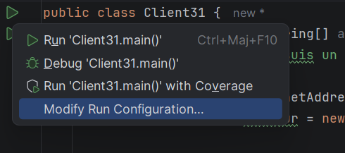
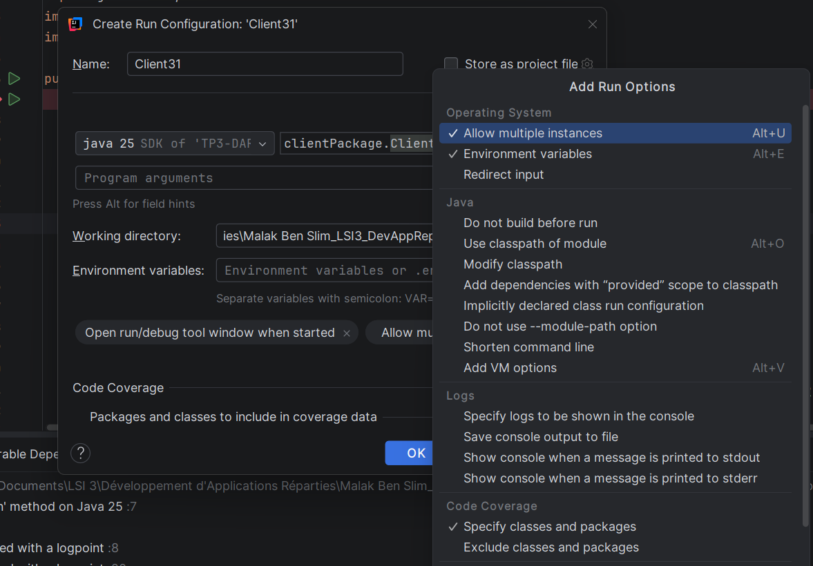
Interprétation : par défaut, IntelliJ n'autorise qu'une instance par configuration. Dans *Modify Run Configuration*, j'ai activé l'option qui permet de lancer plusieurs instances de `Client31` en parallèle (onglets `Client31` séparés dans la fenêtre *Run*).

#### Lancement : le serveur d'abord, puis les clients
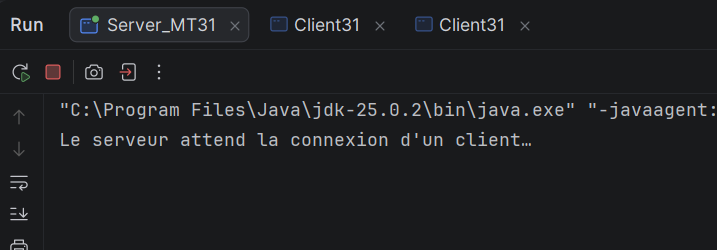
Interprétation : le serveur affiche "Le serveur attend la connexion d'un client…" et reste bloqué sur `accept()`.

### Test local avec des clients Java

#### Connexion du client n°1
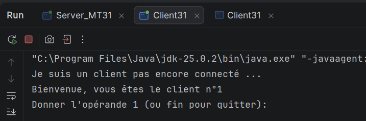
Interprétation : le client se connecte, reçoit du serveur `Bienvenue, vous êtes le client n°1` puis demande l'opérande 1.

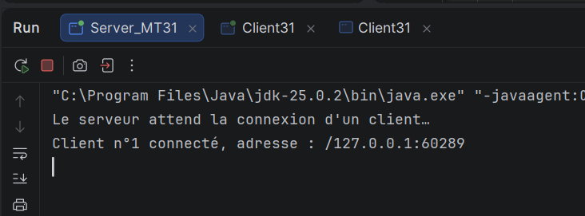
Interprétation : côté serveur, `Client n°1 connecté, adresse : /127.0.0.1:60289` apparaît quand `accept()` se débloque. On voit le numéro d'ordre, l'adresse IP et le port source du client.

#### Test d'une opération avec le client n°1
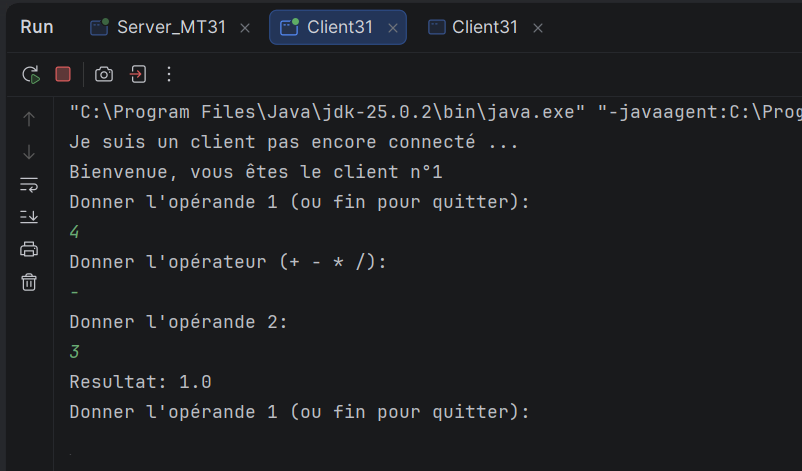
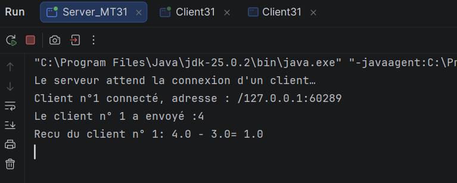

Interprétation : pour 4 - 3, le client n°1 affiche `Resultat: 1.0`. Le serveur affiche l'opération reçue du client n°1 (`4.0 - 3.0 = 1.0`).

#### Connexion du client n°2 pendant que le client n°1 est toujours connecté
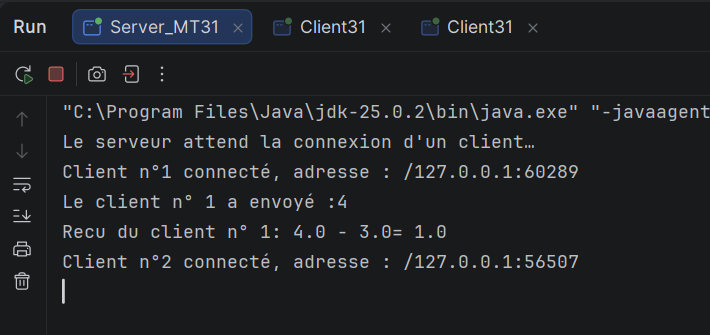
Interprétation : le serveur accepte un deuxième client (`/127.0.0.1:56507`) sans que le client n°1 soit déconnecté. C'est la preuve que le serveur gère plusieurs clients en même temps.

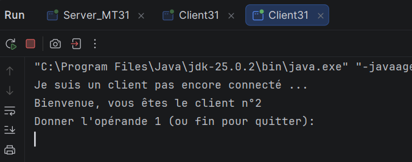
Interprétation : le client n°2 reçoit `Bienvenue, vous êtes le client n°2`, donc son propre numéro d'ordre.

#### Test d'une opération avec le client n°2
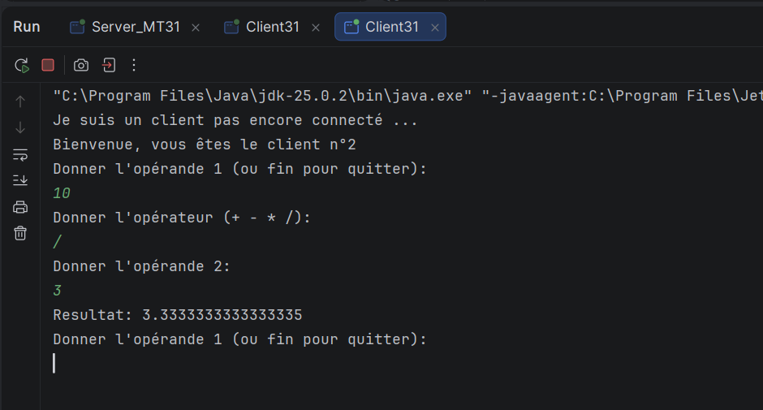
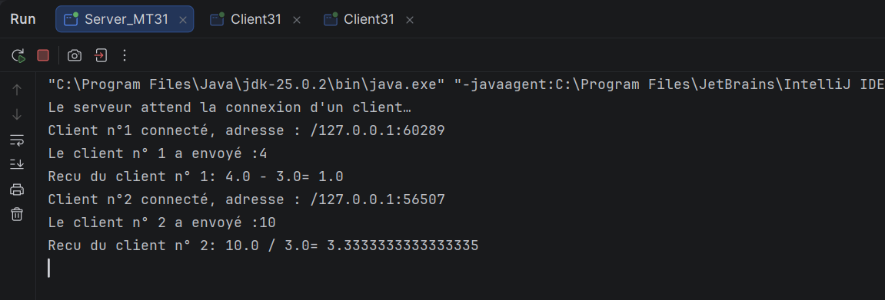

Interprétation : pour 10 / 3, le client n°2 affiche `Resultat: 3.3333333333333335`. La division est réelle car les opérandes sont convertis en `double`. Le serveur affiche l'opération du client n°2 avec son numéro.

#### Remarque sur les adresses IP
Les deux clients ont la **même adresse IP** (`127.0.0.1`) : ils tournent sur la même machine, et `127.0.0.1` désigne la machine elle-même. Ce qui les distingue, ce sont leurs **ports** (`60289` et `56507`), attribués par le système d'exploitation. Le couple IP:port identifie chaque connexion de façon unique. Des adresses IP différentes n'apparaissent que si les clients sont sur des machines différentes.

### Test avec des clients Telnet

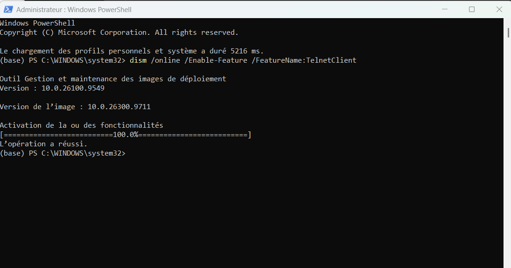
Interprétation : Telnet n'est pas activé par défaut sous Windows. Je l'ai activé avec la fonctionnalité « Client Telnet » (commande `dism /online /Enable-Feature /FeatureName:TelnetClient` dans PowerShell en administrateur).

#### Connexion du client n°3
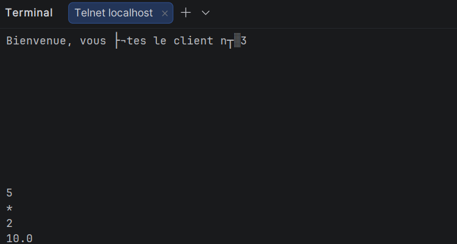
Interprétation : un client Telnet (non Java) se connecte au serveur et reçoit son numéro d'ordre (client n°3). Les caractères accentués s'affichent mal car le serveur envoie en UTF-8 alors que le terminal Telnet utilise CP850. Le client saisit ensuite l'opérande, l'opérateur et l'opérande sur trois lignes, et reçoit le résultat.

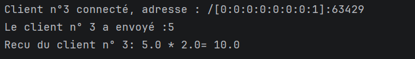
Interprétation : côté serveur, `Client n°3 connecté, adresse : /[0:0:0:0:0:0:0:1]:63429` apparaît. L'adresse `0:0:0:0:0:0:0:1` est `localhost` en **IPv6** (équivalent de `127.0.0.1`) : Telnet a résolu `localhost` en IPv6, alors que mes clients Java utilisaient `127.0.0.1`. Le serveur accepte les deux. Le client Telnet n'affiche aucune invite : j'ai saisi l'opérande 1, l'opérateur et l'opérande 2 chacun sur une ligne. Le serveur affiche `Le client n° 3 a envoyé :5` puis `Recu du client n° 3: 5.0 * 2.0= 10.0`, donc le calcul du client n°3 est bien traité comme celui des clients Java.

#### Déconnexion du client n°1 : le serveur continue de servir le client n°2
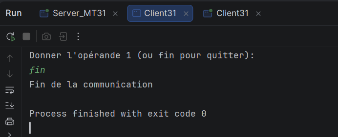
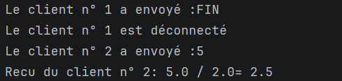
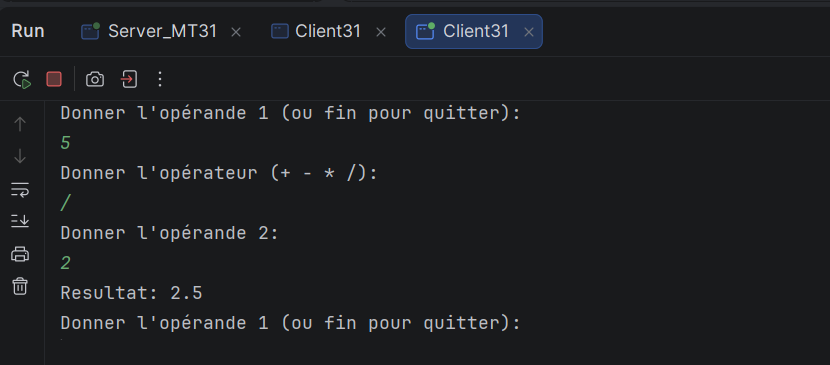

Interprétation : le client n°1 saisit `fin` et envoie `FIN` : le serveur affiche `Le client n° 1 est déconnecté`, et seul le thread de ce client se termine. Le serveur n'est pas arrêté : le client n°2, toujours connecté, envoie ensuite 5 / 2. Le serveur affiche `Recu du client n° 2: 5.0 / 2.0= 2.5` et le client n°2 affiche `Resultat: 2.5`. Les clients sont donc bien indépendants : la fin d'un client n'affecte pas les autres.
### Synthèse
- Le serveur est multi-thread : un thread `ClientProcess31` est créé pour chaque client, ce qui permet à `accept()` de rester disponible pour de nouvelles connexions.
- Le serveur affiche l'IP, le port et le numéro d'ordre de chaque client, et envoie à chaque client son numéro.
- Les captures montrent le client n°2 accepté et servi alors que le client n°1 est encore connecté : les communications sont indépendantes.
- La variable `numero` n'est modifiée que par le thread principal, donc il n'y a pas d'accès concurrent à cet endroit.

### Fermeture des sockets
Comme dans les activités précédentes, je n'ai pas écrit `socket.close()` : les flux sont déclarés dans le `try-with-resources` de `ClientProcess31` et du client, donc Java les ferme automatiquement à la sortie du bloc.

### Remarques
- Le serveur doit toujours être lancé avant les clients. Sinon, le client affiche `ConnectException`.
- Si un client se déconnecte sans envoyer `FIN`, `readLine()` retourne `null` : seul le thread de ce client se termine, le serveur continue de fonctionner.
- Si une opérande n'est pas un nombre, le serveur capture `NumberFormatException` et renvoie `Erreur: opérande invalide`.
- Si l'opérateur est incorrect, le client affiche "Opérateur incorrect, réessayez." sans rien envoyer au serveur.

## Activité 3-2 : Amélioration de l'application calculatrice

### Étape 1 : Création du serveur multi-thread pour le service de calculatrice
Je continue dans le même projet `TP3-DAR2026`. J'ai créé un package `CommonPackage` qui contient la classe `Operation` (reprise de l'activité 2-2 du TP2), et les classes `Server_MT32`, `ClientProcess32` et `Compteur` (package `serverPackage`) et `Client32` (package `clientPackage`). Elles sont développées à partir de l'activité 3-1 (un thread par client) et de l'activité 2-2 (échange d'objets).

Structure du projet :
```
TP3-DAR2026/src
├── clientPackage
│   ├── Client31.java
│   └── Client32.java
├── CommonPackage
│   └── Operation.java
└── serverPackage
    ├── ClientProcess31.java
    ├── ClientProcess32.java
    ├── Compteur.java
    ├── Server_MT31.java
    └── Server_MT32.java
```

#### Principe
Dans l'activité 2-2, le serveur ne traitait qu'un seul client. Maintenant, le service de calculatrice est intégré dans un serveur multi-thread : plusieurs clients peuvent envoyer des **objets `Operation`** en même temps, et leurs opérations sont traitées en parallèle.

- `Server_MT32` boucle sur `accept()` sur le port `1234`. À chaque connexion, il incrémente `numero`, affiche le numéro d'ordre et l'adresse du client, puis démarre un thread `ClientProcess32`. Il joue le même rôle que `Server_MT31`.
- `ClientProcess32` est le thread dédié à un client. Il reprend le traitement de `Server22` : il reçoit un objet `Operation` avec `readObject()`, calcule le résultat, puis le renvoie sous forme de `String` avec `writeObject()` (ce qui permet aussi de renvoyer les messages d'erreur).
- `Client32` reprend `Client22` : il lit l'opération au clavier, vérifie la syntaxe, crée un objet `Operation`, l'envoie au serveur et affiche le résultat reçu. La connexion utilise `InetAddress` et `InetSocketAddress`, avec un délai maximal de 5 secondes (`connect(serveur, 5000)`).
- `Operation` implémente `Serializable` et doit être exactement la même classe (même package, même nom) côté client et côté serveur.
  Comme dans l'activité 2-2, je crée d'abord l'`ObjectOutputStream`, puis l'`ObjectInputStream`, des deux côtés, pour éviter le blocage. Chaque `ClientProcess32` crée **ses propres flux** sur **sa propre socket**, donc la communication avec chaque client est indépendante.

Pour terminer, le client saisit `fin` : il envoie un objet `Operation` dont l'opérateur est `"FIN"`. Seul le thread de ce client se termine, le serveur continue de fonctionner.

#### Lancement : le serveur d'abord, puis les clients
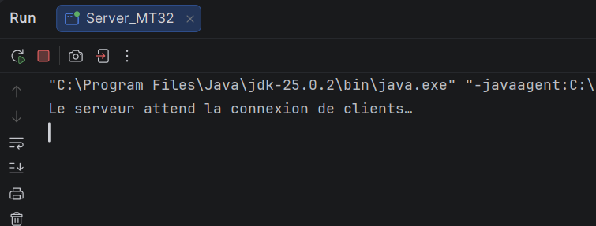
Interprétation : le serveur affiche "Le serveur attend la connexion de clients…" et reste bloqué sur `accept()`.

#### Test local : connexion et opération du client n°1
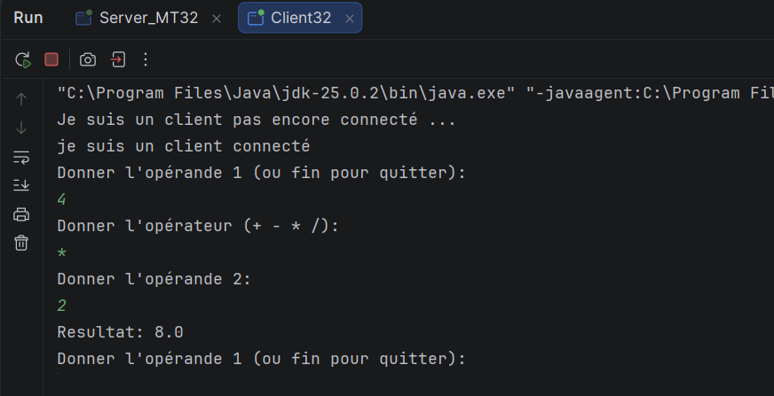
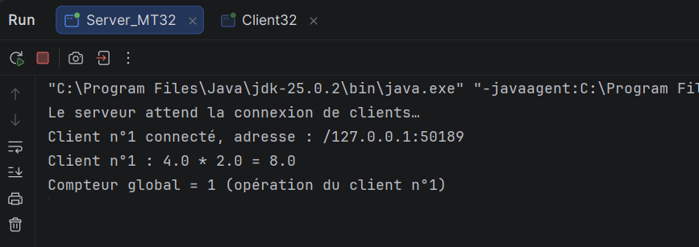

Interprétation : pour 4 * 2, le client n°1 envoie un objet `Operation` et affiche `Resultat: 8.0`. Côté serveur, `Client n°1 connecté, adresse : /127.0.0.1:50189` apparaît quand `accept()` se débloque, puis `Client n°1 : 4.0 * 2.0 = 8.0`. Le message `Compteur global = 1 (opération du client n°1)` correspond au compteur de l'étape 1.

#### Test local : connexion et opération du client n°2 (le client n°1 est toujours connecté)
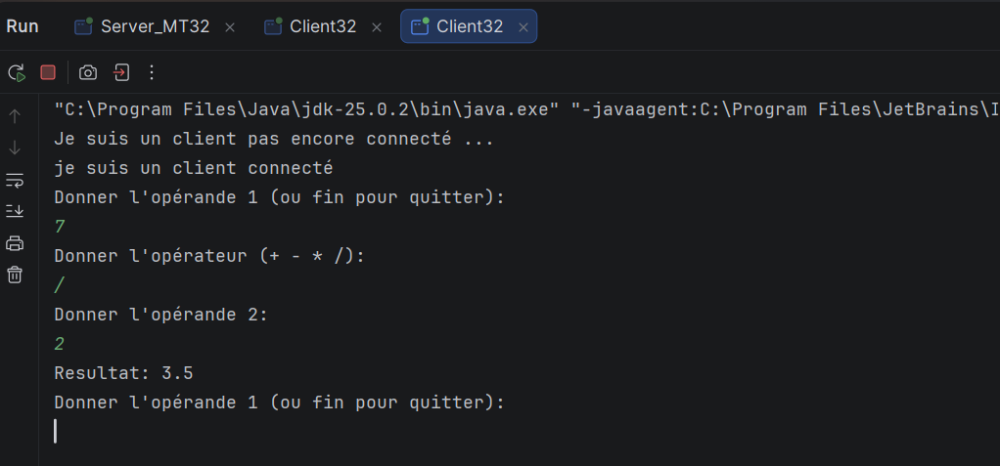
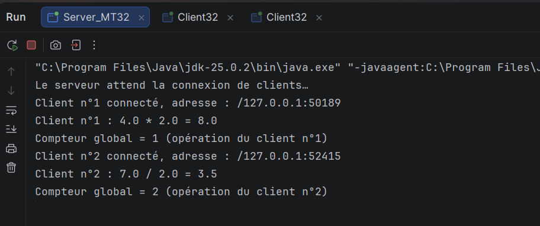

Interprétation : un deuxième client est accepté (`/127.0.0.1:52415`) sans que le client n°1 soit déconnecté. Pour 7 / 2, le client n°2 affiche `Resultat: 3.5` et le serveur affiche `Client n°2 : 7.0 / 2.0 = 3.5`. Les deux clients ont la même adresse IP (`127.0.0.1`, la machine elle-même) mais des ports différents (`50189` et `52415`).


### Étape 3 : Gestion d'un accès concurrent

#### Principe
Le serveur doit compter le **nombre total d'opérations traitées**, tous clients confondus. Ce compteur est une **ressource critique** : il est partagé par tous les threads `ClientProcess32`.

- La classe `Compteur` contient une variable `static int total`. Comme elle est `static`, tous les threads partagent la même variable.
- La méthode `incrementerEtAfficher(int numeroClient)` est `static synchronized` : un seul thread à la fois peut l'exécuter. Elle incrémente `total` puis affiche sa nouvelle valeur.
- `ClientProcess32` appelle `Compteur.incrementerEtAfficher(numero)` après chaque opération calculée.
  Le message affiché est de la forme :

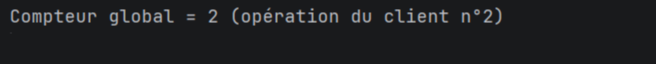
  
- `Compteur global = 2` : nombre total d'opérations traitées par le serveur, tous clients confondus.
- `(opération du client n°2)` : le client qui a déclenché cette incrémentation. Ce numéro n'intervient pas dans le calcul, il sert seulement à l'affichage.
#### Pourquoi `synchronized`
L'instruction `total++` n'est pas atomique : elle lit la valeur, ajoute 1, puis réécrit le résultat. Si deux threads l'exécutent en même temps, ils peuvent lire la même valeur : une incrémentation est alors perdue ou la même valeur est affichée deux fois. Avec `synchronized`, les threads passent l'un après l'autre. L'incrémentation et l'affichage sont dans la même méthode synchronisée, donc les valeurs apparaissent dans l'ordre (1, 2, 3, …).

#### Test avec plusieurs clients en parallèle
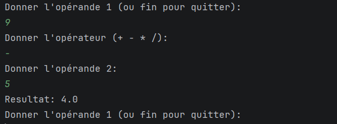
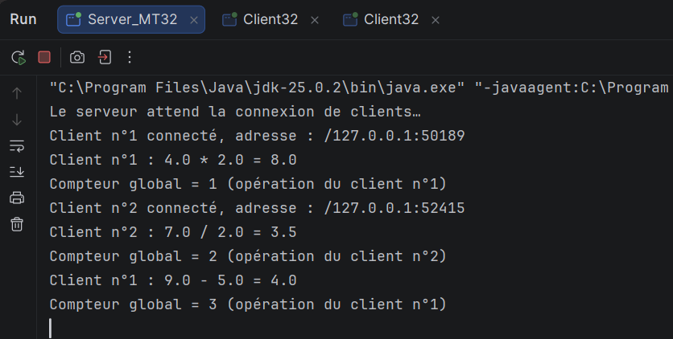

Interprétation : le client n°1 envoie 9 - 5 et reçoit `Resultat: 4.0`. Le serveur affiche `Compteur global = 3 (opération du client n°1)`. C'est la 2e opération du client n°1, mais la 3e du serveur : le compteur est global, il compte aussi l'opération du client n°2 et n'est pas remis à zéro par client.

#### Test de la division par zéro
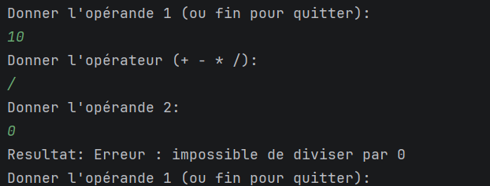
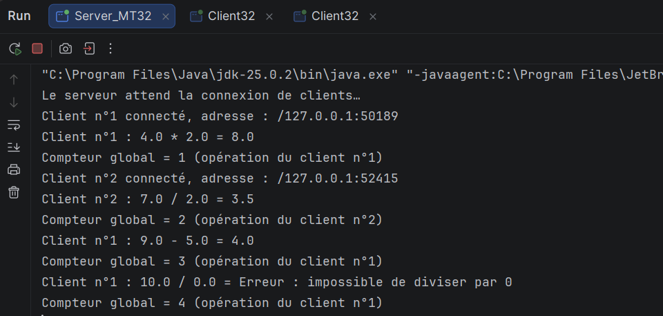

Interprétation : pour 10 / 0, le serveur renvoie `Erreur : impossible de diviser par 0` et ne plante pas. L'opération est quand même comptée : `Compteur global = 4 (opération du client n°1)`.

#### Fin d'un client : l'autre client continue
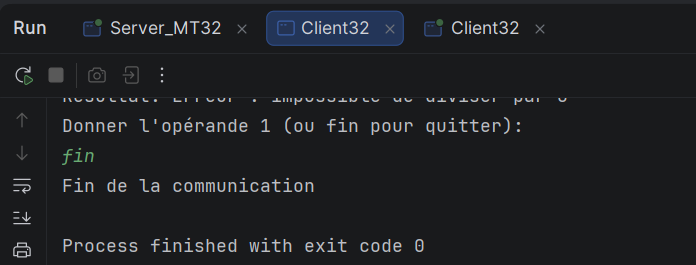

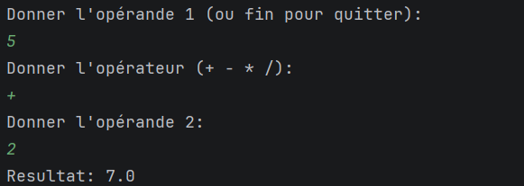

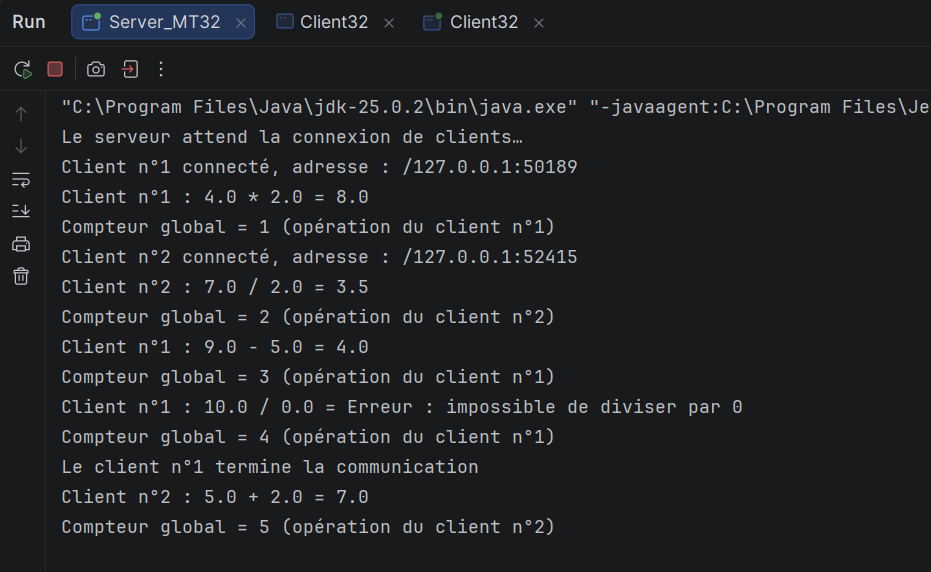

Interprétation : le client n°1 saisit `fin`, affiche "Fin de la communication" et se termine avec `exit code 0`. Le serveur affiche `Le client n°1 termine la communication` : seul le thread de ce client s'arrête. Le client n°2, toujours connecté, envoie 5 + 2 et reçoit `Resultat: 7.0`. Le serveur affiche `Client n°2 : 5.0 + 2.0 = 7.0` puis `Compteur global = 5 (opération du client n°2)`.

#### Vue d'ensemble du compteur global
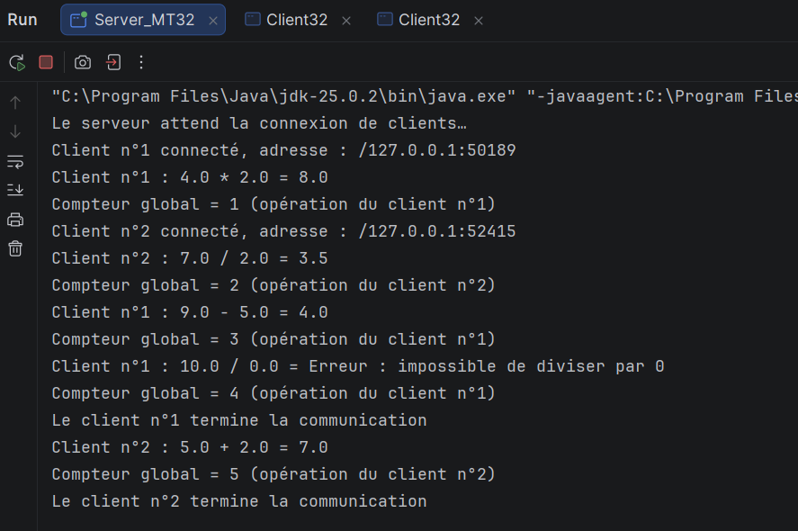

Interprétation : la console du serveur montre le compteur passer de 1 à 5 dans l'ordre, sans doublon ni saut, avec des opérations venant de deux clients : 1 (client n°1), 2 (client n°2), 3 (client n°1), 4 (client n°1), 5 (client n°2). Le compteur reste donc cohérent. À la fin, le serveur affiche `Le client n°2 termine la communication` et continue de fonctionner.

Remarque : ces opérations ont été saisies à la main, donc deux threads ont peu de chances de modifier le compteur exactement au même moment. `synchronized` garantit la cohérence même dans ce cas : sans lui, des valeurs pourraient être perdues ou répétées, ce que montre le test facultatif ci-dessous.


### Synthèse
- Le service de calculatrice est intégré dans un serveur multi-thread : un thread `ClientProcess32` est créé pour chaque client, et l'échange se fait par objets `Operation`.
- `Operation` est sérialisable et doit être la même classe des deux côtés.
- Le compteur global est une ressource critique partagée par tous les threads. Sa méthode est `static synchronized` pour que l'incrémentation et l'affichage se fassent sans conflit : les valeurs restent cohérentes avec plusieurs clients en parallèle.
- La variable `numero` n'est modifiée que par le thread principal : elle n'a pas besoin de synchronisation, contrairement au compteur.
### Fermeture des sockets
Je n'ai pas écrit `socket.close()` : la socket et les flux sont déclarés dans le `try-with-resources` de `ClientProcess32` et de `Client32`, donc Java les ferme automatiquement.

### Remarques
- Le serveur doit toujours être lancé avant les clients.
- `Operation` doit avoir le même package (`CommonPackage`) et le même nom des deux côtés, sinon `readObject()` lève une `ClassNotFoundException`.
- Si un client se déconnecte sans envoyer `FIN`, `readObject()` lève une `EOFException` : le serveur affiche "Le client n°X s'est déconnecté" et seul le thread de ce client se termine. En cas de coupure brutale, une autre `IOException` peut être levée : le serveur affiche alors "Erreur avec le client n°X" et le serveur continue de fonctionner.
- Pour le test en réseau, l'adresse IP du serveur est écrite dans `Client32` : elle doit être modifiée selon la machine serveur.
